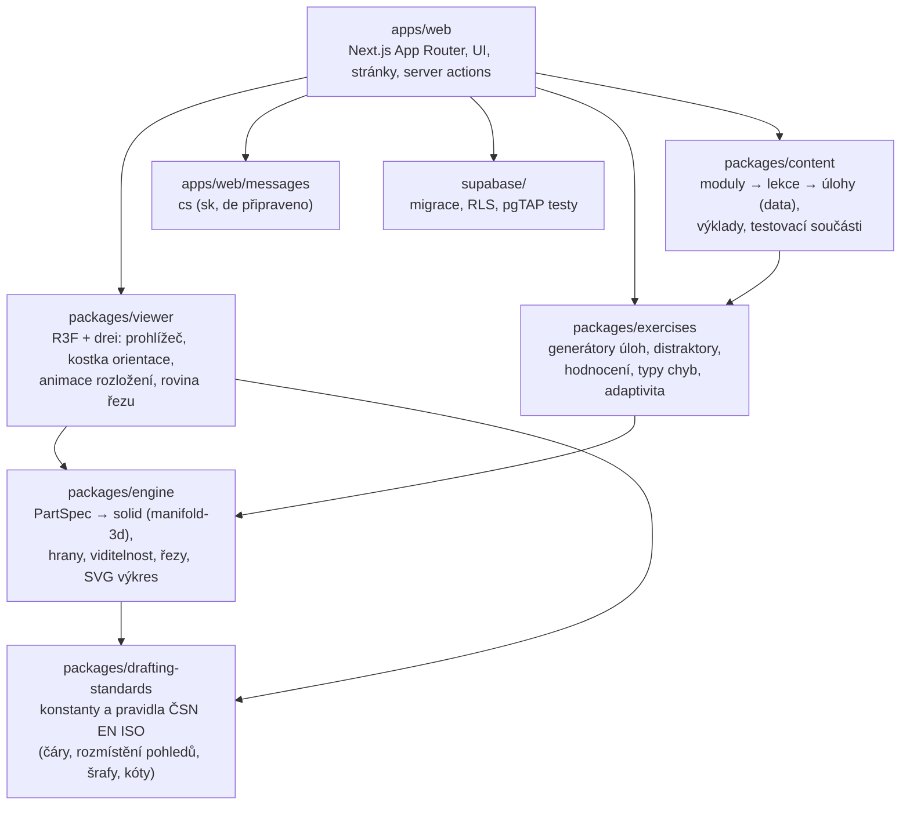

# Výkresovna – plán pilotní verze

> Stav: **návrh k odsouhlasení** (krok 1 zadání). Žádný aplikační kód zatím neexistuje.
> Pracovní název produktu: Výkresovna. Modul pilotu: **„Pohledy a řezy jednoduchých součástí“**.

Obsah:

1. [Shrnutí v kostce](#1-shrnutí-v-kostce)
2. [Architektura a struktura repozitáře](#2-architektura-a-struktura-repozitáře)
3. [Engine: geometrie, projekce, výkres](#3-engine-geometrie-projekce-výkres)
4. [Srovnání přístupů ke skrytým hranám a volba](#4-srovnání-přístupů-ke-skrytým-hranám-a-volba)
5. [Cvičení, distraktory a adaptivita](#5-cvičení-distraktory-a-adaptivita)
6. [Datový model a RLS](#6-datový-model-a-rls)
7. [Nefunkční požadavky: výkon, přístupnost, i18n, GDPR](#7-nefunkční-požadavky)
8. [Testovací strategie a CI](#8-testovací-strategie-a-ci)
9. [Fáze a odhad složitosti](#9-fáze-a-odhad-složitosti)
10. [Rizika](#10-rizika)
11. [Otázky na Jiřího](#11-otázky-na-jiřího)

---

## 1. Shrnutí v kostce

- **Monorepo (pnpm workspaces)**: jedna Next.js aplikace `apps/web` a čisté TypeScript balíčky
  `packages/engine` (geometrie a výkres, bez Reactu), `packages/viewer` (React Three Fiber komponenty),
  `packages/drafting-standards` (odborná pravidla a konstanty), `packages/exercises` (úlohy, distraktory,
  hodnocení). Engine tak půjde beze změn použít pro pozdější modul stereometrie.
- **Geometrie**: parametrická součást = kvádr + seznam prvků (díra, drážka, osazení, zkosení, výřez, žebro),
  boolovské operace přes `manifold-3d` (WASM, ve Web Workeru). `three-bvh-csg` ověřím jen jako záložní
  variantu v úvodním prototypu fáze 1.
- **Skryté hrany ve 2D výkresu**: analytický výpočet viditelnosti hran na CPU (rozdělení hran v průmětu
  + test zákrytu paprskem přes BVH), doplněný o informace z parametrického generátoru (osy děr, přesné
  kružnice a obrysové přímky válců). Výstup je čisté SVG, deterministické a testovatelné v Node bez GPU.
  GPU přístup přes depth buffer použijeme jen pro „rentgen“ skrytých hran v živém 3D prohlížeči.
- **Backend**: nový Supabase projekt v EU (Frankfurt), Auth + Postgres + RLS. Každý řádek s daty účastníka
  nese `org_id`; organizace nikdy nevidí data jiné organizace, ověřeno pgTAP testy v CI.
- **Hosting**: **Vercel** (nativní podpora Next.js, náhledové deploye pro každý PR, funkce v regionu
  Frankfurt vedle Supabase). Cloudflare by vyžadoval adaptér OpenNext a víc ladění.
- **Obsah (moduly, lekce, typy úloh) jako kód** v repozitáři, verzovaný v gitu. V databázi jen odkazy
  (slugy) a výsledky. Úlohy se generují deterministicky ze `seed`, takže se dají kdykoli znovu přehrát
  i ověřit na serveru.
- **Pořadí**: po fázi 2 bude nasazený veřejný demo režim (bez přihlášení), se kterým můžeš jít na schůzky,
  zatímco pokračují fáze 3–5.

---

## 2. Architektura a struktura repozitáře

### 2.1 Vrstvy a závislosti



Pravidla závislostí (hlídá ESLint `import/no-restricted-paths` / `boundaries`):

- `engine` a `drafting-standards` neimportují React, Next.js, DOM ani Supabase. Běží v prohlížeči,
  ve Web Workeru i v Node (testy, serverové ověření výsledků).
- `exercises` nezná UI. Vrací data úlohy a vyhodnocení s kódy chyb; texty vysvětlení řeší UI přes i18n.
- `viewer` zná three.js a React, ale nezná cvičení ani databázi.
- Jen `apps/web` mluví se Supabase.

### 2.2 Struktura složek

```
vykresovna/
├─ apps/
│  └─ web/                         Next.js (App Router) + TypeScript + Tailwind
│     ├─ app/
│     │  ├─ [locale]/(marketing)/  landing „Pro firmy“, „Pro školy“, zásady zpracování, formulář pilotu
│     │  ├─ [locale]/demo/         demo režim bez přihlášení (3–5 úloh + showcase 3D)
│     │  ├─ [locale]/(app)/        přihlášená část: moduly, lekce, úlohy, postup
│     │  ├─ [locale]/(app)/skolitel/  skupiny, přiřazení lekcí, přehled, export CSV
│     │  ├─ [locale]/(app)/admin/  admin organizace: licence, školitelé, kód organizace
│     │  └─ api/                   route handlers: certifikát PDF, export CSV
│     ├─ components/               UI komponenty (bez natvrdo psaných textů)
│     ├─ lib/supabase/             klienti (browser/server), typy generované z DB
│     ├─ messages/                 cs.json (sk.json, de.json připraveno)
│     ├─ workers/                  Web Worker pro engine (CSG + výkres mimo hlavní vlákno)
│     └─ e2e/                      Playwright testy a vizuální snapshoty
├─ packages/
│  ├─ drafting-standards/          ODBORNÁ PRAVIDLA na jednom místě + testy (viz 3.6)
│  ├─ engine/
│  │  ├─ src/part/                 PartSpec, prvky, validace, generátor → manifold
│  │  ├─ src/csg/                  obal nad manifold-3d (inicializace WASM, převody)
│  │  ├─ src/edges/                extrakce hran (ostré hrany, obrysy válců), původ hran
│  │  ├─ src/projection/           pohledy, kamera, viditelnost hran (HLR)
│  │  ├─ src/section/              řez rovinou, průřezová plocha, šrafování
│  │  ├─ src/dimensions/           kóty z prvků součásti
│  │  ├─ src/drawing/              sestavení výkresu (rozmístění pohledů) a export do SVG
│  │  ├─ src/sources/              zdroje geometrie: parametrický (teď), STEP přes occt-import-js (později)
│  │  └─ test/fixtures/            10 testovacích součástí
│  ├─ viewer/                      R3F komponenty: Viewer, ViewCube, UnfoldAnimation, SectionPlane, EdgeHighlight
│  ├─ exercises/                   typy úloh 1–6, mutace (distraktory), hodnocení, adaptivita
│  └─ content/                     modul „Pohledy a řezy“: lekce, obtížnosti, výklady (klíče do i18n)
├─ supabase/
│  ├─ migrations/                  SQL migrace (schéma, RLS, funkce)
│  ├─ tests/                       pgTAP testy RLS (izolace organizací, role)
│  └─ seed.sql                     testovací organizace a uživatelé (jen lokálně)
├─ docs/
│  ├─ plan.md                      tento dokument
│  └─ decisions.md                 záznam rozhodnutí (proč jsme co zvolili)
├─ .github/workflows/ci.yml        lint, typecheck, Vitest, pgTAP, build, Playwright
├─ CLAUDE.md                       konvence, příkazy, architektura
└─ package.json, pnpm-workspace.yaml, tsconfig.base.json
```

Interní balíčky se konzumují přímo jako TypeScript zdroj (Next.js `transpilePackages`), bez vlastního build
kroku. Turborepo přidáme, až by CI začalo být pomalé.

**Drobná odchylka od zadání**: místo `/lib/drafting-standards` navrhuji `packages/drafting-standards`.
Důvod: pravidla potřebuje engine, a engine je samostatný balíček oddělený od aplikace, takže pravidla
nemůžou žít uvnitř `apps/web/lib`. Pořád je to jeden modul s konstantami a testy, jen o patro jinde.

### 2.3 Technologie

| Oblast | Volba | Poznámka |
|---|---|---|
| Frontend | Next.js (App Router, aktuální stabilní verze), React, TypeScript strict, Tailwind | dle zadání |
| 3D | three.js + React Three Fiber + drei | dle zadání |
| Boolovské operace | `manifold-3d` (WASM, Apache-2.0) | `three-bvh-csg` jen jako záloha po prototypu |
| Akcelerace dotazů | `three-mesh-bvh` (MIT) | raycast pro viditelnost hran, výběr hran myší |
| Stav UI | zustand | sdílené zvýraznění hrany 3D ↔ 2D, stav cvičení |
| Drag & drop | dnd-kit | má vestavěné ovládání klávesnicí (cvičení 1) |
| i18n | next-intl | `cs` výchozí, `sk` a `de` připravené |
| Backend | Supabase (Postgres, Auth, RLS), region eu-central-1 | nový samostatný projekt |
| E-mail | Resend (nebo SMTP dle tvé volby) | notifikace z formuláře „Chci pilot“ |
| PDF | `@react-pdf/renderer` na serveru, vložený font s češtinou | certifikát |
| Hosting | Vercel, funkce v regionu `fra1` | viz 2.4 |
| Testy | Vitest, fast-check (property testy), Playwright, pgTAP | |
| Kvalita | ESLint (flat config) + Prettier, `eslint-plugin-i18next` (zákaz textů natvrdo v JSX) | |

### 2.4 Hosting: Vercel vs. Cloudflare

| Kritérium | Vercel | Cloudflare |
|---|---|---|
| Podpora Next.js App Router | nativní, bez konfigurace | přes adaptér OpenNext, část funkcí s omezeními |
| Náhledové deploye pro PR | ano, automaticky | ano, ale víc nastavování |
| Region vedle Supabase (Frankfurt) | ano (`fra1`) | edge všude, Node runtime omezeně |
| Cena pro komerční pilot | plán Pro (Hobby nesmí komerčně) | velmi levné |

**Volba: Vercel.** Je to nejkratší cesta k profesionálně běžící aplikaci; případný přechod na Cloudflare
později nebrání nic v architektuře.

---

## 3. Engine: geometrie, projekce, výkres

### 3.1 Souřadnice (zamknuté konstantami a testy v `drafting-standards`)

- Engine používá pravotočivou soustavu jako CAD: **X doprava, Y dozadu (do hloubky), Z nahoru**, jednotky mm.
  Převod na three.js (Y nahoru) dělá jen `viewer`.
- Nárys (pohled zepředu): pozorovatel na straně −Y, dívá se ve směru +Y.
- Půdorys (pohled shora): pozorovatel nahoře, dívá se ve směru −Z. Ve výkresu leží **pod** nárysem.
- Bokorys zleva: pozorovatel na straně −X, dívá se ve směru +X. Ve výkresu leží **vpravo** od nárysu.
- Pohled zprava vlevo od nárysu, pohled zdola nad nárysem, pohled zezadu úplně vpravo.
- Pro každý pohled je pevně dán směr pohledu a vektor „nahoru“ v obrázku. Test ověří, že po rozložení
  Mongeových průměten vycházejí přesně tato umístění a že sousední pohledy jsou správně svázané
  (výška nárysu = výška bokorysu, šířka nárysu = šířka půdorysu, hloubka půdorysu = šířka bokorysu,
  zadní strana tělesa přiléhá u půdorysu i bokorysu k nárysu).

### 3.2 Parametrická součást (`PartSpec`)

Součást je JSON popis, ne síť trojúhelníků:

```ts
// ilustrační tvar, ne finální kód
type PartSpec = {
  id: string
  base: { kind: 'block'; size: [number, number, number] }   // celá čísla v mm
  features: Feature[]                                       // aplikují se v pořadí
}
type Feature =
  | { kind: 'hole'; through: boolean; diameter: number; depth?: number; axis: 'x'|'y'|'z'; at: [number, number]; face: FaceRef }
  | { kind: 'slot'; width: number; depth: number; along: 'x'|'y'; face: FaceRef; offset: number }  // drážka
  | { kind: 'step'; edge: EdgeRef; width: number; height: number }                                 // osazení
  | { kind: 'chamfer'; edge: EdgeRef; size: number }                                               // zkosení
  | { kind: 'cutout'; face: FaceRef; rect: [number, number, number, number]; depth: number }       // výřez / kapsa
  | { kind: 'rib'; from: FaceRef; thickness: number; height: number; length: number }              // žebro
```

Proč takhle:

- **Sémantika prvků je cenná**: z ní plynou osy děr (čerchované osy ve výkresu), kóty (průměr, vzdálenost
  osy od hrany), přesné kružnice místo mnohoúhelníků a hlavně **mutace pro distraktory** (posuň díru,
  odeber drážku, zrcadli).
- Validace prvků (díra se vejde do tělesa, prvky se nekříží nesmyslně) je čistá funkce s testy.
- `manifold-3d` přenáší přes boolovské operace identifikátor původního tělesa (`originalID`) u každého
  trojúhelníku. Díky tomu u každé plochy výsledku víme, ze kterého prvku vznikla (např. „vnitřní plocha
  díry #2“).

Generátor běží ve **Web Workeru** (WASM se načte jednou, UI se nezasekne). Stejný kód běží v Node pro testy.

### 3.3 Extrakce hran

1. Sloučení koplanárních trojúhelníků do ploch (podle normály a původu).
2. **Ostré hrany**: hrany mezi plochami s úhlem nad prahem (konstanta). Hrany teselace válce se vynechají.
3. **Obrysové přímky válců** (pohledově závislé): u děr a válcových ploch je spočteme analyticky z osy
   a poloměru (tečné površky v daném směru pohledu), ne z teselace.
4. Každá hrana dostane stabilní `edgeId` a odkaz na prvek, ze kterého vznikla. Na tom stojí zvýraznění
   3D ↔ 2D i vysvětlení chyb („chybí hrana dna drážky“).

### 3.4 Výkres (SVG)

- Pro každý pohled: průmět hran → viditelnost (kapitola 4) → sloučení kolineárních úseků → odstranění
  překryvů (když se viditelná a skrytá čára kryjí, kreslí se viditelná; pořadí přednosti čar je konstanta
  v `drafting-standards`, k potvrzení).
- Osy děr a rovin souměrnosti z `PartSpec` (čerchovaná tenká, přesah přes obrys je konstanta).
- Kružnice se vykreslí jako `<circle>`/oblouk, ne jako mnohoúhelník.
- Styly čar jsou **SVG třídy** generované z konstant (`stroke-width`, `stroke-dasharray`), takže změna
  normy = změna jedné konstanty. Tloušťky v mm a výkres v měřítku 1:1 v mm (`viewBox` v mm), tisk funguje
  bez převodů.
- Každý prvek SVG nese `data-edge-id` → propojení s 3D.
- Souřadnice zaokrouhlené na 0,01 mm, aby byly snapshoty stabilní.
- Volitelně zjednodušené popisové pole se **značkou evropského promítání** (výukově užitečné; viz otázky).

### 3.5 3D prohlížeč (`packages/viewer`)

- Otáčení, zoom, posun, reset; přepínání pravoúhlé/perspektivní kamery (pravoúhlá odpovídá výkresu).
- Kostka orientace s českými popisky (zepředu, shora, zleva…), kliknutím natočí kameru do pohledu.
- Hrany kreslené jako čáry nad tělesem; režim „rentgen“ ukáže skryté hrany čárkovaně (GPU depth test).
- **Animace rozložení (hlavní aha moment)**: těleso uvnitř tří průměten (nárysna vzadu, půdorysna dole,
  bokorysna vpravo, jak to odpovídá evropskému promítání). Kroky animace: (1) průmětny se objeví,
  (2) promítací paprsky „přenesou“ hrany na průmětny a nakreslí výkres, (3) půdorysna se sklopí dolů
  a bokorysna vytočí doprava do roviny nárysny, (4) kamera plynule přejde do čelního pohledu
  a 3D výkres splyne s SVG výkresem. Ovladač s časovou osou (pauza, krok zpět), ne jen „přehrát“.
  Stejné rozmístění bere z `drafting-standards`, takže animace a výkres nemůžou být v rozporu.
- **Interaktivní řez**: rovina řezu tažením; v reálném čase přes clipping planes + stencil buffer
  (uzavření řezné plochy s texturou šraf). Přesný 2D řez (šrafovaný polygon z `manifold.slice`)
  se přepočítá po puštění roviny.
- **Zvýraznění**: najetí na hranu ve 3D zvýrazní tutéž hranu ve všech pohledech 2D a naopak
  (sdílený stav `hoveredEdgeId`).
- Vykreslování na vyžádání (`frameloop="demand"`), adaptivní rozlišení a fallbacky viz kapitola 7.

### 3.6 `packages/drafting-standards`

Jediné místo pro odborná pravidla. Obsahuje jen konstanty a čisté funkce, každá s testem a s komentářem
vlastními slovy (bez citací norem):

- metoda promítání (`PROJECTION_METHOD = 'E'`), směry pohledů, **rozmístění pohledů vůči nárysu**,
- typy čar (viditelná, skrytá, osa, kótovací/pomocná, stopa řezu) a jejich tloušťky a vzory čárkování,
- pořadí přednosti překrývajících se čar,
- šrafování (úhel 45°, rozteč, pravidla pro více ploch jedné součásti),
- kótování (formát čísla bez jednotky, umístění textu nad čarou, čitelnost zdola/zprava, odstupy, šipky),
- označení řezu (A–A), stopa roviny řezu se zesílenými konci a šipkami,
- česká terminologie (klíče do i18n),
- americké promítání jen jako výslovně pojmenovaná výuková varianta (`THIRD_ANGLE_DEMO_ONLY`),
  aby ho nešlo omylem použít jinde.

Vše, co si nejsem jistý, bude označené `// TODO(norma)` a je v seznamu otázek (kapitola 11).

### 3.7 Příprava na budoucí rozšíření (teď nestavíme)

- **Stereometrie (B2C)**: engine pracuje s obecným „tělesem“ (síť + volitelná metadata prvků), ne jen
  s kvádrem. Hranoly, jehlany a válce jsou jen další zdroje geometrie; řez rovinou a projekce jsou společné.
  Framework cvičení je obecný (typ úlohy = generátor + hodnocení). V DB může být `org_id` prázdné
  pro individuální uživatele.
- **Import STEP**: rozhraní `PartSource`; implementace přes `occt-import-js` později doplní síť bez
  metadat prvků. Viditelnost hran funguje i bez nich (jen kružnice budou mnohoúhelníky a osy se musí
  odvodit). Pozor: `occt-import-js` je pod licencí LGPL, ověříme před použitím.

---

## 4. Srovnání přístupů ke skrytým hranám a volba

Požadavek: ze 3D tělesa vytvořit pro každý pohled **vektorový** výkres, kde jsou viditelné hrany plně
a skryté čárkovaně, a to **spolehlivě** (výkres je základ všech cvičení i distraktorů).

### Přístup A: GPU, dva průchody přes depth buffer

Vykreslí se těleso do depth bufferu, pak hrany dvakrát: s testem hloubky „blíž“ (viditelné) a „dál“ (skryté).

- \+ Jednoduché, rychlé, ideální pro **živý 3D pohled** z libovolného úhlu.
- − Výsledek je rastr. Pro SVG by se musel vektorizovat, nebo se musí hrany vzorkovat a hloubka číst
  zpět z GPU (`readPixels`) → přesnost omezená rozlišením.
- − Hrany leží přímo na povrchu tělesa, takže test hloubky je na hraně nejednoznačný (z-fighting);
  nutné posuny hloubky, které jinde způsobí chyby (krátké hrany „prosvítají“ nebo mizí).
- − Netestovatelné v Node bez GPU, snapshoty závislé na ovladači grafiky.

### Přístup B: analytická viditelnost hran na CPU (zvolený)

Pro každý pohled: (1) promítnout všechny hrany do 2D, (2) každou hranu rozdělit v místech, kde ji
v průmětu kříží jiné hrany nebo obrysy (jen tam se může viditelnost změnit), (3) pro střed každého
úseku vyslat paprsek směrem k pozorovateli a přes BVH (`three-mesh-bvh`) zjistit, zda ho něco zakrývá,
(4) sloučit úseky a vyřešit překryvy. Doplněno o analytické obrysy válců a přesné kružnice z `PartSpec`.

- \+ Přesný **vektorový výstup**, přímo SVG, s `edgeId` u každé čáry.
- \+ **Deterministický a testovatelný v Node** (Vitest), stejný výsledek na každém počítači → spolehlivé
  snapshoty a serverové ověření úloh.
- \+ Pro naše součásti (stovky až nízké tisíce trojúhelníků) rychlý: odhad desítky ms na pohled.
- \+ Bez velkých závislostí (BVH už potřebujeme pro výběr hran myší).
- − Musíme ho napsat a vyladit tolerance (hrany na povrchu, téměř souběžné hrany, tečné body).
  Riziko zmírňují testovací součásti se známým správným výsledkem.

### Přístup C: přesné HLR nad B-rep modelem (OpenCascade přes WASM)

Průmyslový standard (takhle to dělá např. FreeCAD TechDraw): `HLRBRep` nad přesnou geometrií.

- \+ Nejpřesnější, skutečné oblouky a obrysy křivých ploch, i pro složité součásti.
- − WASM balík v řádu desítek MB → pomalé načítání na školních PC, problém pro demo na schůzce.
- − Složité API, slabší údržba JS obalů, licence LGPL. Nahradil by i `manifold-3d`.
- − Pro kvádry s dírami a drážkami je to kanón na vrabce.

### Srovnání

| Kritérium | A: GPU depth | B: CPU analyticky | C: OpenCascade HLR |
|---|---|---|---|
| Spolehlivost skrytých hran | střední (z-fighting, rozlišení) | **vysoká** (s laděním tolerancí) | nejvyšší |
| Vektorový SVG výstup | ne / složitě | **ano** | ano |
| Testy v Node, stabilní snapshoty | ne | **ano** | ano (pomalé) |
| Velikost pro prohlížeč | nic navíc | malá | desítky MB |
| Pracnost | nízká | střední | vysoká |
| Kružnice a válce | mnohoúhelníky | přesné díky metadatům prvků | přesné |

**Volba: B pro 2D výkres + A jen pro živý „rentgen“ ve 3D prohlížeči.** C necháme jako možnost pro
budoucí import složitých STEP součástí (případně až na serveru).

Ověření v prvním kroku fáze 1: 10 testovacích součástí (kvádr; kvádr s průchozí dírou ve třech osách;
slepá díra; drážka; osazení; zkosení; výřez v rohu; žebro; kombinace s dírou za drážkou, kde skrytá hrana
probíhá za jinou skrytou hranou; součást se souběžnými hranami v průmětu). U každé ručně ověřený
očekávaný výkres a vizuální snapshot. Tyto výkresy ti ukážu před pokračováním.

---

## 5. Cvičení, distraktory a adaptivita

### 5.1 Model úlohy

- Každý typ úlohy = `generate(seed, difficulty) → TaskInstance` a `evaluate(task, answer) → Result`.
- `Result` obsahuje správnost, skóre a **kódy chyb** (např. `LAYOUT_THIRD_ANGLE`, `TOP_SIDE_SWAPPED`,
  `HIDDEN_AS_VISIBLE`, `MISSING_EDGE`, `MIRRORED`, `FEATURE_SHIFTED`, `WRONG_SECTION_PLANE`,
  `DIMENSION_WRONG_FEATURE`). Kód chyby → vysvětlení vlastními slovy (i18n) + zvýraznění místa ve 3D/2D.
- Uloží se jen `seed`, obtížnost, verze enginu, odpověď a výsledek. Úloha jde kdykoli přesně znovu
  vygenerovat (náhled pro školitele, serverové ověření skóre pro certifikát).

### 5.2 Šest typů cvičení

| # | Cvičení | Fáze | Poznámka k implementaci |
|---|---|---|---|
| 1 | Přiřaď pohledy (drag & drop na pozice evropského promítání) | 2 | dnd-kit, ovládání klávesnicí; chyba „americké rozmístění“ rozpoznaná zvlášť |
| 2 | Najdi chybějící pohled (1 ze 4) | 2 | nejtěžší distraktory jsou ty, které se shodují ve dvou daných pohledech |
| 3 | Výkres → model (1 ze 4 modelů) | 2 | 4 malé 3D náhledy; distraktor musí mít jiný aspoň jeden ze 3 pohledů |
| 4 | Najdi chybu ve výkresu | 3 | mutace výkresu (ne tělesa): chybějící/přebytečná hrana, plná místo čárkované, špatné umístění pohledu; klikací oblasti |
| 5 | Řez: vyber správný řez A–A, nebo umísti rovinu řezu | 3 | plný řez v MVP, poloviční řez připravený v datovém modelu |
| 6 | Odečti kótu | 3 | kóty z prvků `PartSpec`; odpověď číslem, tolerance 0 (kóty jsou celá čísla) |

### 5.3 Generátor distraktorů

Mutace na dvou úrovních:

- **těleso**: posun prvku, odebrání prvku, přidání prvku, zrcadlení, změna průchozí díry na slepou,
  změna rozměru prvku,
- **výkres**: záměna viditelné a skryté hrany, odebrání nebo přidání hrany, záměna evropského a amerického
  rozmístění, prohození půdorysu a bokorysu.

Klíčová pojistka: **každý distraktor musí být vizuálně odlišný** od správné odpovědi i od ostatních
distraktorů v pohledech, které uživatel vidí. Engine spočítá kanonický otisk (hash) 2D výkresu každého
pohledu; mutace, která dá stejný výkres (např. zrcadlení souměrné součásti), se zahodí a zkusí se jiná.
Bez toho by vznikaly úlohy se dvěma správnými odpověďmi. Hlídá to property test přes tisíce seedů.

Obtížnost 1–5 určuje počet a typ prvků a „vzdálenost“ distraktoru od správné odpovědi
(1: kvádr s výřezem, distraktory hrubě odlišné; 5: díry + osazení + řez, distraktory se liší jedinou hranou).

### 5.4 Obsah modulu

Modul → lekce → úlohy. Návrh lekcí pilotního modulu (k připomínkování):

1. Proč výkres a jak vznikají pohledy (animace rozložení), přiřazení pohledů.
2. Viditelné a neviditelné hrany.
3. Díry a osy.
4. Drážky, osazení, zkosení.
5. Chybějící pohled a čtení výkresu → model.
6. Chyby ve výkresu.
7. Řez a šrafování.
8. Kóty: čtení rozměrů.
9. Závěrečný test modulu (podklad pro certifikát).

Před každou lekcí krátký interaktivní výklad (1–2 obrazovky, s živým 3D, ne zeď textu).

### 5.5 Adaptivita (jednoduchá)

Pro každého uživatele se počítá četnost kódů chyb s klesající vahou starších pokusů. Výběr další úlohy
v lekci upřednostní typy a mutace, ve kterých uživatel chybuje (např. opakovaně plete skryté hrany →
víc úloh s distraktorem „plná místo čárkované“). Čistá funkce v `packages/exercises` s testy.

### 5.6 Demo režim

3–5 vybraných úloh (pevné seedy pro předvídatelnou ukázku + tlačítko „další varianta“) a 3D showcase
s animací rozložení. Běží čistě v prohlížeči, nic se neukládá. Odkaz typu `vykresovna.cz/demo`.

---

## 6. Datový model a RLS

### 6.1 Principy

- Každá tabulka ve schématu `public` má zapnuté RLS (test to vynucuje).
- Osobní údaje jen: jméno (zobrazované), e-mail (v `auth.users`), členství v organizaci.
- Každý záznam o výsledcích nese **`org_id`, ve které vznikl**. Pracovník agentury, který je členem
  dvou firem, tak má v každé firmě vidět jen výsledky z té firmy.
- Obsah (moduly, lekce, úlohy) je v kódu; DB ukládá jen slugy.
- Zápisy, které vyžadují kontrolu (připojení kódem, přijetí pozvánky, vydání certifikátu, smazání účtu),
  jdou přes `security definer` funkce nebo serverové akce, ne přímým insertem z klienta.

### 6.2 Tabulky

| Tabulka | Klíčové sloupce | Účel |
|---|---|---|
| `organizations` | `id`, `name`, `kind` (`company`/`school`), `join_code` (unikátní), `seat_limit`, `license_valid_until`, `created_at` | firma nebo škola |
| `profiles` | `id` (= `auth.users.id`), `display_name`, `locale`, `created_at` | minimum osobních údajů |
| `memberships` | `user_id`, `org_id`, `role` (`participant`/`trainer`/`org_admin`), `created_at`; unikátní (`user_id`, `org_id`) | role v organizaci |
| `invitations` | `id`, `org_id`, `email` (volitelně), `role`, `group_id` (volitelně), `token_hash`, `expires_at`, `accepted_at`, `created_by` | pozvánky |
| `groups` | `id`, `org_id`, `name`, `created_by`, `archived_at` | skupina/třída |
| `group_members` | `group_id`, `user_id`, `role` (`trainer`/`participant`) | kdo je ve skupině, kdo ji vede |
| `assignments` | `id`, `group_id`, `module_slug`, `lesson_slug`, `due_at`, `created_by` | přiřazené lekce |
| `attempts` | `id`, `user_id`, `org_id` (nullable pro budoucí B2C), `module_slug`, `lesson_slug`, `exercise_type`, `difficulty`, `seed`, `engine_version`, `answer` (jsonb), `is_correct`, `score`, `error_codes` (text[]), `duration_ms`, `created_at` | každý pokus; jen přidávání |
| `lesson_progress` (view, `security_invoker`) | odvozeno z `attempts` | stav lekcí pro účastníka i přehled školitele |
| `certificates` | `id`, `user_id`, `org_id`, `module_slug`, `score`, `holder_name` a `org_name` (snímek v době vydání), `verification_code`, `issued_at` | certifikát PDF |
| `pilot_requests` | `id`, `name`, `company`, `email`, `headcount`, `segment` (`company`/`school`), `message`, `consent_at`, `created_at` | formulář „Chci pilot“ |
| `platform_admins` | `user_id` | ty: zakládání organizací, licence |
| `usage_counters` (volitelně) | `day`, `event`, `count` | anonymní analytika bez osobních údajů |

Klíčové funkce (`security definer`, `set search_path = ''`):

- `join_organization(code)`: ověří kód, licenci a počet míst, vytvoří `membership` jako `participant`.
- `accept_invitation(token)`: ověří token a platnost, vytvoří členství a případně zařadí do skupiny.
- `is_org_member(org)`, `has_org_role(org, roles[])`, `is_group_trainer(group)`: pomocné funkce pro politiky.
- `delete_my_account()`: volá serverová akce; smaže profil, členství a pokusy (kaskádou přes `auth.users`).

### 6.3 Politiky RLS (přehled)

| Tabulka | SELECT | INSERT | UPDATE / DELETE |
|---|---|---|---|
| `organizations` | členové org | jen platform admin (server) | `org_admin` (název), licence jen platform admin |
| `profiles` | sám sebe; školitel/admin vidí jméno členů své org | trigger při registraci | sám sebe |
| `memberships` | vlastní řádky; `org_admin` celé org; školitel členy svých skupin | jen přes funkce | `org_admin` mění role; uživatel může org opustit |
| `invitations` | `org_admin` a školitelé dané org | `org_admin`, školitel (jen role `participant`) | tvůrce nebo `org_admin` |
| `groups` | školitelé a admin dané org; členové skupiny | školitel/admin dané org | vedoucí skupiny nebo admin |
| `group_members` | sám sebe; vedoucí skupiny; admin org | vedoucí skupiny nebo admin | vedoucí skupiny nebo admin |
| `assignments` | členové a vedoucí skupiny | vedoucí skupiny | vedoucí skupiny |
| `attempts` | vlastní; vedoucí skupiny, kde je uživatel, **a zároveň `attempt.org_id` = org skupiny**; `org_admin` dané org | jen vlastní (`user_id = auth.uid()`) a jen pro org, kde je členem | nikdo (jen kaskáda při smazání účtu) |
| `certificates` | vlastní; školitel/admin dané org; veřejné ověření kódu jen přes funkci s minimem údajů | jen server po ověření skóre | nikdo |
| `pilot_requests` | nikdo z klientů | jen serverová akce (service role) s validací a ochranou proti spamu | nikdo |

`auth.uid()` se v politikách obaluje jako `(select auth.uid())` (doporučení Supabase kvůli výkonu).

### 6.4 Testy RLS

- **pgTAP** přes `supabase test db`, spouštěné v CI proti lokální instanci Supabase (Docker).
- Seed: dvě organizace (A, B), v každé admin, dva školitelé, účastníci; jeden účastník členem obou.
- Matice testů: pro každou tabulku a roli ověřit, že **z org A nejde přečíst ani zapsat nic z org B**,
  že školitel vidí jen své skupiny, že pokusy agenturního pracovníka z firmy B nejsou vidět ve firmě A,
  že anonym nevidí nic kromě veřejných funkcí.
- Metatest: žádná tabulka v `public` nemá vypnuté RLS a žádná nemá politiku `using (true)` bez výslovné výjimky.

---

## 7. Nefunkční požadavky

### 7.1 Výkon a slabý hardware

- Vykreslování jen při změně (`frameloop="demand"`): statická scéna nezatěžuje GPU ani baterii tabletu.
- drei `PerformanceMonitor` + adaptivní rozlišení (DPR 1–2), bez stínů, jednoduché materiály,
  hrany jako levné `LineSegments` (tlusté čáry jen na silnějším HW).
- CSG a výkres ve Web Workeru, výsledky v cache podle `PartSpec` (hash).
- Kódové rozdělení: 3D a WASM se načtou až na stránkách, které je potřebují; landing načte lehkou ukázku.
- Fallback bez WebGL nebo při velmi nízkém fps: statické SVG výkresy + předrenderované obrázky, cvičení
  2–6 fungují i bez živého 3D.
- Cíl: 60 fps na integrované grafice typu Intel UHD 620 a na běžném tabletu; měřeno v Playwright
  s omezením CPU a ručně na reálném HW (viz otázky).

### 7.2 Přístupnost

- Všechna cvičení ovladatelná klávesnicí (dnd-kit má klávesnicový režim, výběry jsou tlačítka/radio).
- Skryté hrany se liší **vzorem čáry**, ne jen barvou; barva je jen doplněk.
- Kontrast WCAG AA, viditelný focus, výsledek úlohy oznámený i přes `aria-live`.
- Respektování `prefers-reduced-motion` (animace rozložení jde krokovat ručně).

### 7.3 i18n

- next-intl, URL s prefixem jazyka (`/cs/…`), texty v `messages/cs.json`. Struktura připravena pro `sk` a `de`.
- ESLint pravidlo zakazuje texty natvrdo v JSX. Odborné termíny (nárys, půdorys…) jsou klíče
  z `drafting-standards`, aby byly jednotné všude.

### 7.4 GDPR a nezletilí

- Data v EU (Supabase Frankfurt, funkce Vercel `fra1`), zpracovatelské smlouvy (DPA) se Supabase, Vercel, Resend.
- Jen nezbytné cookies (session přihlášení) → není potřeba cookie lišta. Žádné reklamy, žádné trackery
  třetích stran. Analytika jen anonymní (vlastní počítadla v DB bez osobních údajů, nebo Plausible; viz otázky).
- Stránka zásad zpracování, smazání účtu v profilu, retence `pilot_requests` a pokusů definovaná.
- Školy a firmy budou správci údajů svých lidí, Výkresovna zpracovatel → bude potřeba vzor
  zpracovatelské smlouvy (právní věc mimo kód, jen upozorňuji).

---

## 8. Testovací strategie a CI

| Úroveň | Nástroj | Co testuje |
|---|---|---|
| Odborná pravidla | Vitest | konstanty, rozmístění pohledů, styly čar, formát kót |
| Engine | Vitest | generátor (objem, uzavřenost sítě, rozměry), viditelnost hran na známých součástech, textové snapshoty SVG |
| Cvičení | Vitest + fast-check | pro tisíce seedů: distraktory odlišné, vždy jedna správná odpověď, hodnocení a kódy chyb |
| Databáze | pgTAP | RLS izolace organizací a rolí, funkce připojení a pozvánek |
| UI a hlavní cesty | Playwright | demo, přihlášení, připojení kódem, cvičení, dashboard, export CSV, certifikát |
| Vizuální snapshoty | Playwright | 10 testovacích výkresů (PNG), klíčové obrazovky; běží v Docker obrazu Playwright, aby se nelišily podle OS |

CI (GitHub Actions) na každý PR: lint → typecheck → Vitest → pgTAP (Supabase CLI) → build → Playwright.
Vercel k tomu vytvoří náhledový deploy.

---

## 9. Fáze a odhad složitosti

Odhady jsou hrubé, v pracovních dnech vývoje (já + tvoje kontroly), a nejvíc nejistá je fáze 1.

| Fáze | Obsah | Složitost | Odhad | Co potřebuju od tebe |
|---|---|---|---|---|
| **0** | Monorepo, ESLint/Prettier, Vitest, Playwright, CI, Supabase projekt (EU), deploy prázdné aplikace na Vercel, next-intl kostra, CLAUDE.md | S | 1 den | účty/přístupy (Vercel, Supabase), doména, větev `main` |
| **1** | Engine: prototyp CSG (manifold vs. three-bvh-csg), `PartSpec` + generátor, extrakce hran, viditelnost (přístup B), SVG výkres se styly čar a osami, 3D prohlížeč s kostkou orientace, animace rozložení, 10 testovacích součástí se snapshoty | **XL** | 8–12 dní | **kontrola 10 výkresů** před pokračováním, odpovědi na `TODO(norma)` |
| **2** | Cvičení 1–3, generátor distraktorů s kontrolou odlišnosti, hodnocení s vysvětlením chyb, výklad k lekcím 1–5, demo režim, nasazení na doménu | L | 6–8 dní | zpětná vazba k vysvětlivkám a obtížnostem |
| **3** | Cvičení 4–6, interaktivní řez (stencil + šrafy), 2D řez se stopou A–A, kótování z prvků, lekce 6–9, adaptivita | L | 7–9 dní | kontrola řezů a kót |
| **4** | Auth, organizace, role, kód organizace a pozvánky, skupiny, přiřazení lekcí, dashboard školitele, CSV, certifikát PDF, smazání účtu, RLS testy | L | 6–8 dní | text certifikátu, pravidla licencí |
| **5** | Landing (Pro firmy / Pro školy, živá 3D ukázka), formulář „Chci pilot“ + e-mail, zásady zpracování, ladění výkonu na slabém HW, přístupnost | M | 3–5 dní | texty a kontakt, test na reálném školním/firemním PC |

Celkem zhruba **31–43 pracovních dní**.

**Doporučení k pořadí kvůli schůzkám**: po fázi 2 nasadím demo na tvou doménu s jednoduchou úvodní
stránkou (jen odkaz na demo a kontakt). S tím můžeš začít domlouvat schůzky, zatímco běží fáze 3–5.
Plnohodnotná landing page s formulářem pak přijde ve fázi 5 (případně ji můžeme předsunout před fázi 4,
pokud budeš chtít sbírat zájemce dřív).

Po každé fázi se zastavím a napíšu: co je hotové, jak to vyzkoušíš (konkrétní kroky) a co doporučuji dál.

---

## 10. Rizika

| Riziko | Dopad | Zmírnění |
|---|---|---|
| Chyby ve viditelnosti hran v hraničních případech | vysoký: chybné úlohy | testovací součásti se známým výsledkem, property testy, tvá kontrola výkresů ve fázi 1 |
| Odborná nepřesnost (norma) | vysoký: ztráta důvěry u škol a firem | vše v `drafting-standards`, `TODO(norma)`, ideálně kontrola učitelem technické dokumentace |
| Výkon na slabém HW | střední | vykreslování na vyžádání, worker, fallback bez 3D, test na reálném HW |
| Robustnost boolovských operací | střední | prototyp v prvních dnech fáze 1, celočíselné rozměry, validace prvků |
| Automatické rozmístění kót je složité | střední | kótovat jen to, co cvičení potřebuje (prvky z `PartSpec`), ne obecné auto-kótování |
| Uživatelé bez e-mailu (operátoři, agenturní pracovníci) | střední: bariéra pilotu | viz otázka 3 |
| Rozšiřování rozsahu | střední | fáze s jasným „hotovo“, nové nápady do backlogu |

---

## 11. Otázky na Jiřího

**Odborná pravidla** (budou v kódu jako `TODO(norma)`, dokud je nepotvrdíš):

1. **Tloušťky a vzory čar**: navrhuji skupinu čar 0,5 (tlustá 0,5 mm, tenká 0,25 mm) a vzory čárkování
   odvozené z tloušťky čáry podle ISO 128. Souhlasíš, nebo se ve školách/firmách používá jiná skupina?
2. **Skryté hrany**: kreslit je ve cvičeních vždy ve všech pohledech? A v pohledu v řezu skryté hrany
   za rovinou řezu vynechat (běžná praxe)?
3. **Řezy**: žebra v podélném řezu nešrafovat (běžná konvence), nebo se tomu v MVP vyhnout tím, že
   žebra do řezů nedáme? Rozteč šraf pevná, nebo podle velikosti plochy?
4. **Kóty**: velikost písma (navrhuji 3,5 mm), typ šipek, odstupy kótovacích čar od obrysu a mezi sebou,
   přesah pomocných čar, přesah os přes obrys. Máš ověřené hodnoty, nebo je mám navrhnout
   a ty je zkontroluješ?
5. **Popisové pole**: chceš na výkresech zjednodušené popisové pole se značkou evropského promítání?
   Výukově je to užitečné, ale přidává to plochu na obrazovce.
6. **Odborná kontrola**: máš učitele technické dokumentace nebo technologa, který by zkontroloval výkresy
   z fáze 1? Doporučuji to, výrazně to sníží riziko chyb před schůzkami.

**Produkt a provoz:**

7. **Přihlášení bez e-mailu**: operátoři a agenturní pracovníci často nemají firemní e-mail.
   Mám počítat s přihlášením „uživatelské jméno + PIN“, které vytvoří školitel? (Navrhuji ano jako
   doplněk k e-mailu.)
8. **Viditelnost pro školitele**: vidí školitel jen své skupiny (navrhuji, na školách vhodnější),
   nebo všechny účastníky organizace? Admin organizace vidí vše.
9. **Člen více organizací**: může být jeden uživatel členem více firem (agentura)? Navrhuji ano,
   s oddělenými výsledky podle firmy.
10. **Účty a náklady**: založíš účty Vercel (komerční provoz vyžaduje plán Pro, cca 20 USD/měsíc)
    a Supabase (pro pilot doporučuji Pro, cca 25 USD/měsíc, Free projekt se při nečinnosti uspává)?
    Supabase projekt umím založit sám přes propojený konektor, pokud mi řekneš, ve které organizaci
    a na jakém plánu.
11. **Doména a e-mail**: jaká doména a na jakou adresu chodí poptávky z formuláře? Souhlasíš s Resend
    pro odesílání?
12. **Analytika**: stačí vlastní anonymní počítadla v DB (navrhuji), nebo chceš Plausible (placený, EU)?
13. **Certifikát**: hranice úspěšnosti (návrh 80 % v závěrečném testu), ověřovací kód/QR na certifikátu,
    podpis školitele?
14. **Vzhled**: máš logo nebo barvy, nebo mám navrhnout jednoduchou vizuální identitu pro pilot?
15. **Reálné součásti**: máš (anonymizované) příklady dílů z firem, které by šly použít jako inspirace
    pro obtížnost 4–5? Zvýší to věrohodnost u firem.
16. **Cílový HW**: konkrétní typ školního PC nebo tabletu, na kterém mám výkon ověřit?
17. **Repozitář je prázdný**: smím vytvořit větev `main` jako výchozí (z tohoto plánu), aby šly dál
    zakládat PR obvyklým způsobem?

---

*Po schválení začnu fází 0. Změny v plánu zapíšu sem a důvody do `docs/decisions.md`.*
